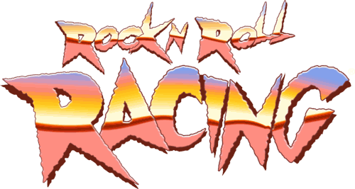
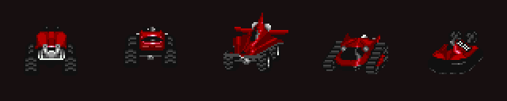
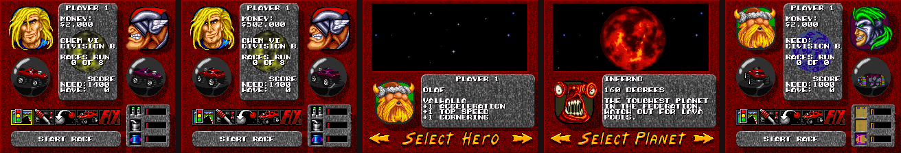
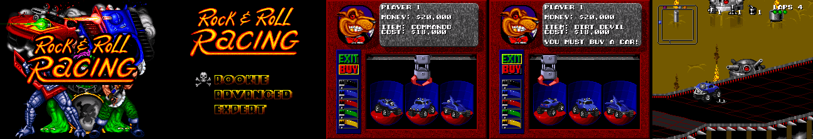
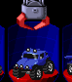

# Rock N' Roll Racing — Password Generator & Secrets

**[Open the password generator →](https://maxxthunder.github.io/rocknrollracing/)** &nbsp; 

- **Make a password** for any racer, planet, division, car, upgrades, weapons and money.
- **Decode a password** you already have to see what it holds, and fix typos.
- **Glitch mode** for values the game never makes itself.
- Works on **Super Nintendo** and **Genesis**. Both use the same password algorithm, so a password from one works on the other. The US, European and Japanese releases all take the same passwords.

Everything here comes from disassembling the ROMs, and **every code below was run in an emulator (BizHawk 2.11)** with its effect checked in RAM or on screen.

## How to use a password

1. On the title screen, choose **PASSWORD**.
2. Type the 12 characters. The game has no letter O or vowels; the generator's decoder fixes common mix-ups like 5/S and 0/Q.
3. Move to **END** and press the button.

## Secret codes

Press each button in a sequence separately; a repeated button means release it and press it again.

**★ New** means the code wasn't listed anywhere before: not on GameFAQs for the Super Nintendo and Genesis, and for the Game Boy Advance, online lists only have GameShark and Action Replay codes. **Known** codes were already published.

### Super Nintendo

| Where | Input | Effect | Status |
|---|---|---|---|
| Title → Password | `B0B! F1TC H!!!` | Skips straight to the ending and credits ([details](#the-bob-fitch-password)) | ★ New |
| Pre-race menu | R, Right, Down, Left, L, Up, Select | +$250,000 (repeatable) | ★ New |
| Buy Equipment | R, Right, R, L, Left, L, Up, Down, Up, Select | Infinite weapon charges | ★ New |
| Advance a Level¹ | Left, Right, L, R, Y, A, X, B, Down, Up, Select | Score set to the amount needed to advance | ★ New |
| Set Options² | Down, Left, Up, Right, R, Down, Right, Up, Left, L, Up, Select | Drive off the track without falling | ★ New |
| Set Options, Larry row (Larry on) | R / L step forward / back through the clips, Select replays | Announcer voice test, 40 clips | ★ New³ |
| Character select | Highlight Tarquinn, hold L+R+Select, press Right | Olaf | Known |
| VS mode planet select | Highlight NHO, hold L+R+Select, press Right | Inferno | Known |

### Genesis

| Where | Input | Effect | Status |
|---|---|---|---|
| Advance a Level¹ | Left, Right, Left, Right, B, C, then hold A+B+Start | Score set to the amount needed to advance | ★ New |
| Title → Password | `RG1Y 5HP1 2F!!` | Skips to the ending | Known |
| Character select / VS planet select | Up, Right, Up, Right, Down, Left, Down, Left, Right | Olaf (one Left of Snake Sanders) / Inferno (after NHO) | Known |
| Pre-race menu | Up, Right, Down, Left, Up, Left, Down, Right, Up | +$250,000 (repeatable: move the cursor away and back between uses) | Known |
| Buy Equipment | Down, Down, Down, Up, Down, Left, Right, Left, Down | Infinite weapon charges (the rivals get them too) | Known |
| Set Options | Down, Left, Up, Right, Down, Right, Up, Left, Right, Left | Drive anywhere | Known |

### Game Boy Advance

The GBA port is the SNES code recompiled, so it keeps the SNES codes. Only the Advance code changed, because the GBA has no X or Y.

| Where | Input | Effect | Status |
|---|---|---|---|
| Advance a Level¹ | Left, Right, L, L, L, R, R, R, Down, Up, Select | Score set to the amount needed to advance | ★ New |
| Pre-race menu | R, Right, Down, Left, L, Up, Select | +$250,000 (repeatable) | ★ New |
| Buy Equipment | R, Right, R, L, Left, L, Up, Down, Up, Select | Infinite weapon charges | ★ New |
| Set Options² | Down, Left, Up, Right, R, Down, Right, Up, Left, L, Up, Select | Drive off the track without falling | ★ New |
| Character select | Highlight Tarquinn, hold L+R+Select, press Right | Olaf | ★ New |
| VS mode planet select | Highlight NHO, hold L+R+Select, press Right | Inferno | ★ New |

¹ Press Left first so the advance arrow is highlighted; if the cursor is on EXIT, the face buttons in the code quit the screen. Once the code is in, the screen exits; choose Advance a Level again and it lets you through. On the Japanese Super Famicom the code has no Y: Left, Right, L, R, A, X, B, Down, Up, Select.
² Start with the cursor on MUSIC. The code's Left/Right presses toggle settings, but they cancel each other out. Starting on EXIT quits the menu instead.
³ A slower workaround was known; stepping through the clips directly with L and R is new.

### Glitch passwords

| Password | Effect | Status |
|---|---|---|
| `GGMR RSSB WS6M` | The game creates this password after the Bob Fitch ending. It puts Olaf in Division B on planet 6, which doesn't exist. The pre-race screen reads "Races run 0 of 0" with garbled images, and START RACE gives a black screen that never recovers. | ★ New |
| `34D0 RQN7 1WJ!` | Corrected version of the published `R4D0 RQN7 1WJ!`, which fails the game's password check. Gives the unnamed super racer on Inferno. | ★ New fix |
| `T5D7 HQPV SWJ!` | The unnamed super racer (character 7) | Known |

All three work on the Super Nintendo. The Genesis accepts them too, but with the super racer (the last two) its pre-race screen draws only the sprites: no menu, background or player portrait.

To make other glitch passwords, turn on Glitch mode in the generator. It unlocks money digits 10–15, colors 5–7, planets 6–7, cars 5–7 and difficulty 3. Here's what each one does on the Super Nintendo:

| Glitch value | What happens |
|---|---|
| Colors 5–7 | Working two-tone paint jobs: teal and purple (5), orange and green (6), green and dark green (7). The password's color goes through a 5-entry table at `$81:C36A`; 5–7 read the code bytes after it (`8B 4B AB`) as palette numbers, so the body colors come from far past the real paints in the table at `$80:D90D` while the trim stays normal. The car picker shows them. Races run normally. |
| Cars 5–7 | The car shows up as a block of noise, in the pre-race bubble and on the track, and it can't drive. There's no art for a sixth car anywhere in the ROMs. |
| Planet 6 | See `GGMR RSSB WS6M` above: garbled pre-race screen, START RACE hangs. |
| Planet 7 | Same as planet 6: "Races run 0 of 1", a garbled rival portrait, and START RACE hangs. |
| Difficulty 3 | Accepted; the pre-race screen and the race look the same as Rookie. |
| Money digit 10–15 | The digit shows as "?" (e.g. "$?02,000"). |

### Other places we looked

- **Hidden screens:** the per-frame screen handler table at `$80:8197` has 18 entries, and normal play reaches all of them, so there's no leftover debug or test screen behind it.
- **Debug switches:** every RAM address the game reads but never writes (found by scanning the GBA's ARM version of the code) was set in the emulator during a race. They only changed how the race played out (they're per-car race tables filled in bulk), and none opened a debug menu or test mode.
- **Unused art:** the GBA stores its sprites uncompressed, and the car shop art covers exactly the five cars, plus effects and a font. There's no portrait or name for the unnamed super racer. The Super Nintendo and Genesis compress their graphics with a format we haven't decoded, so their backgrounds haven't been searched yet.

## Beta builds

Two US Super Nintendo prototypes, both with a blank cartridge header.

**Beta 1** is an early build. Seen in the emulator:

- **The Commando, a sixth car.** It's a lifted jeep with a bull bar, sold for $18,000 in the first car shop between the Dirt Devil and the Marauder. It has its own spinning shop art and drives normally in a race. The final game drops it and its name; its cars are Battle Trak, Havac, Dirt Devil, Marauder and Air Blade.
- **"Rock & Roll Racing"** on the title screen, not "Rock N' Roll".
- **Rookie, Advanced and Expert** instead of Rookie, Veteran and Warrior.
- **Shop messages** in the info panel, such as YOU MUST BUY A CAR! when you try to leave without one.

In the ROM text but not seen on screen:

- More shop messages: CAN'T AFFORD IT, NOTHING TO BUY!, THE CAR IS FULL!, SAME CAR YOU HAVE!, YOU HAVE THAT! and USELESS ON YOURS!
- **Rednaugh Zypher**, an earlier name for Ivanzypher, in a second list of racer names that sits next to the rivals' names. The character select already says Ivanzypher.
- Two-player text: LEAVE OTHER PLAYER BEHIND? and PLANETS NOT THE SAME!, probably for when only one player qualifies to advance and for two players' passwords being on different planets.
- YOU HAVE ENOUGH / NOT ENOUGH PTS, END OF SEASON and WELCOME TO BAY2, from earlier versions of the advance and season screens.
- The typos ROGUE MISSLE and LIGHTINING NITRO, fixed only in the final game.

Its password check uses a 13-bit checksum instead of 16 bits and has no Bob Fitch password, so final-game passwords most likely won't work in it (not tested).

**Beta 2** is nearly final: the same title, menus, password code and Bob Fitch password as the retail game. The differences are the ROGUE MISSLE / LIGHTINING NITRO typos and the missing "for use only on NTSC compatible systems" region screen.

## Regions

| Release | Passwords | Notes |
|---|---|---|
| Super Nintendo, US and Europe | Same | Password and button-code routines are byte-identical, at the same addresses |
| Super Famicom, Japan | Same | Same logic, key, checksum and Bob Fitch value, $8B bytes later in the ROM. The Advance code has no Y |
| Genesis, US and Europe | Same | Identical apart from one relocated jump and the Advance code table moving to `$13C02` |
| Game Boy Advance, US and Europe | None | No password screen; six battery-backed save slots instead ([save format](#game-boy-advance-saves)) |

## The cast

Snake Sanders, Cyberhawk, Ivanzypher, Katarina Lyons, Jake Badlands and Tarquinn are the playable racers, and Olaf is the secret one. The rivals, in the ROM's own order, are Viper Mackay, Grinder X19, Ragewortt, Roadkill Kelly, Butcher Icebone and J.B. Slash, plus Rip and Shred, who race on every planet. "Ragewortt" is spelled that way in the SNES, Genesis and GBA ROMs. The shopkeeper is Fast Eddie, and the man on the Advance a Level screen is Captain Braddock.

## Technical notes

<b>The Bob Fitch password</b>

The name comes from programmer Bob Fitch, who is credited under Programming with Pat Wyatt and Allen Adham. The decoder checks for one hard-coded value at `$81:BE12`. When it matches, the game sets Olaf, Warrior, Inferno, Division A and 30 points, then jumps to the end-of-season routine. Inferno is the last planet, so the full ending plays: Hall of Heroes, highlight clips, credits and THE END. Some side effects:

- The end-of-season screen reads "Score needed to advance 000", because the code never sets the required score.
- Car, money, upgrades and color are never set, so they keep whatever was entered before. The new-game password prefilled on the entry screen supplies the Marauder and $2,000.
- After the ending, the game stores the planet-6 password `GGMR RSSB WS6M` (see the glitch passwords above).

The Genesis port byte-swapped the first three words of the check value. That's why its version, `RG1Y 5HP1 2F!!`, looks scrambled.

<b>How the password works</b>

| SNES address | Genesis address | Routine |
|---|---|---|
| `$81:C2A5` | `$93D8` | Alphabet `BCDFGHJKLMNPQRSTVWXYZ0123456789!` (5 bits per character) |
| `$81:BF5D` | `$9004` | Encode: pack fields into a 64-bit register (SNES `$13C4`) |
| `$81:C266` / `$C277` | `$938E` / `$93AA` | Push / pull n bits at the top of the register |
| `$81:C256` | `$9372` | Checksum: `w0 ^ w1 ^ w2 ^ w3 ^ $6573` over the 16-bit words |
| `$81:C024` | `$90DE` | XOR the register with `B29A 56B2 B2EB B200` |
| `$81:C236` | `$934E` | Emit 12 characters, 5 bits each, starting from the top bit |
| `$81:BDE9` | `$8DF6` | Decode: the reverse, plus the special-password check |

Fields are pushed in this order. Each push shifts the register right, so the first field ends up in the last characters:
front(3) rear(3) middle(3) engine(2) tires(2) shocks(2) armor(2) car(3) color(3) planet(3) division(1) character(3) money0(4) money1(4) money2(4) difficulty(2), then the 16-bit checksum.

- **Money:** three decimal digits, in thousands.
- **Division:** 0 = A, 1 = B.
- **Car:** follows the ROM's name table: Battle Trak, Havac, Dirt Devil, Marauder, Air Blade. (The generator lists them by shop price instead.)
- **Color:** stored as a slot 0–4 (black, blue, red, green, yellow) and remapped through a table (SNES `$C364`/`$C36A`, Genesis `$9497`/`$949D`). Slots 5–7 read past the end of that table.

<b>How the button codes work</b>

| | SNES | Genesis |
|---|---|---|
| Held buttons | `$033D` | `$4282(a4)` |
| New presses | `$034D` | `$428C(a4)` |
| Sequence matcher | `$81:9BFC` | `$1C90` |
| "Code entered" flag | `$0245` | `$3A20(a4)` |

Each frame, the matcher compares the held buttons with the next entry in a code table. Still holding the previous button is allowed, and anything else resets the code. When it reaches the `$FFFF` end marker, it sets the flag, and the current screen applies its effect.

| Effect | SNES | Genesis |
|---|---|---|
| Infinite weapon charges | `$0247` skips the ammo decrements | `$3A22` skips the ammo decrements |
| Drive anywhere | Clears `$0B4B` | Clears `$4E2E` |
| Olaf / Inferno | Held combo `cmp #$2130` at `$81:A912` (characters) and `$81:A8B5` (VS planets) | Sequence code |

On the GBA, RAM sits $100 lower than on the SNES and the GBA buttons report the same bits as the SNES ones. The four sequence tables are at `0x08032CBC` (Buy Equipment), `0x0803AA6F` (pre-race), `0x0803BF4B` (options) and `0x08046C31` (advance). The matcher is at `0x08032CD4` and has exactly four callers. The two hold-button checks are at `0x08036384` and `0x0803657C`. The European GBA ROM has the same tables.

<b>Game Boy Advance saves</b>

The GBA port is a static recompile of the SNES 65816 code into ARM. Its saves still use the password packer, with two changes:

- Two extra fields go in first, before the usual 44 bits: an 8-bit value at SNES-style RAM `$01A8`, then a 4-bit slot holding `$1AEE` (a 0–3 counter that picks the music track).
- The checksum shrinks to 4 bits: the low nibble of the same `w0 ^ w1 ^ w2 ^ w3 ^ $6573`.

The total is still 60 bits and 12 characters, with the same XOR key. After a new game is saved to slot 1, RAM holds `BNRRHHHXZN4B`, which decodes this way to the new-game setup: Snake Sanders, Chem VI, Division B, $2,000, a Marauder, and 1/1/1 charges. The decoder has no special-password check, so there's no Bob Fitch password on the GBA. Routines: decode `0x0803D2D8`, unpack `0x0803EF74`, push/pull `0x0803F2CC`/`0x0803F36C`, checksum `0x0803F274`, XOR `0x0803E08C`.

<b>Files</b>

| File | What it is |
|---|---|
| `index.html` | The generator page |
| `rnrr.js` | Password encode/decode, ported from the ROM |
| `test.mjs` | `node test.mjs` round-trips published passwords through the codec |
| `tools/disasm.py`, `tools/disasm68k.py`, `tools/reasm*.py` | Full-ROM disassemblers and reassemblers (from the Soldiers of Fortune project) |
| `disasm/snes/`, `disasm/genesis/` | US ROM listings that reassemble byte-identical; `disasm/names.txt` labels the password, input and cheat routines and RAM |
| `img/characters.png`, `img/rock_n_roll_racing_logo.png` | Page art: racer portraits (8 × 2 tiles of 64 px) and the logo |
| `img/planets/` | The six planets, captured from the SNES VS mode planet select (99 px, transparent) |
| `img/upgrades/` | Engine, tires, shocks, armor and weapon icons, captured from the SNES Buy Equipment screen (the Marauder's items) |
| `img/cars/` | Spinning car sheets from the SNES car shop: 24 frames of 64 px across (one full turn, 4 game frames each) and the 8 paints down (5–7 the glitch paints, built from the ROM palette), rebuilt from VRAM, OAM and CGRAM with real transparency |
| `img/readme/` | Images for this README |

To run the page locally, serve the folder, e.g. `python -m http.server`. ROMs are not included.

## Found another code?

[Open an issue](https://github.com/maxxthunder/rocknrollracing/issues) with the version, the screen, the buttons and what happens.

## Credits and legal

*Rock N' Roll Racing* is © 1993 Interplay Productions and Silicon & Synapse (now Blizzard Entertainment). This project isn't affiliated with or endorsed by Blizzard or Interplay. The game art on the page and in this repo (portraits, logo, planets, cars, icons and screenshots) belongs to them and is used here for reference. The disassembly listings are for research; no ROMs are included.

The code in this repo (the generator, codec, tests and tools) is released under the [MIT License](LICENSE).
